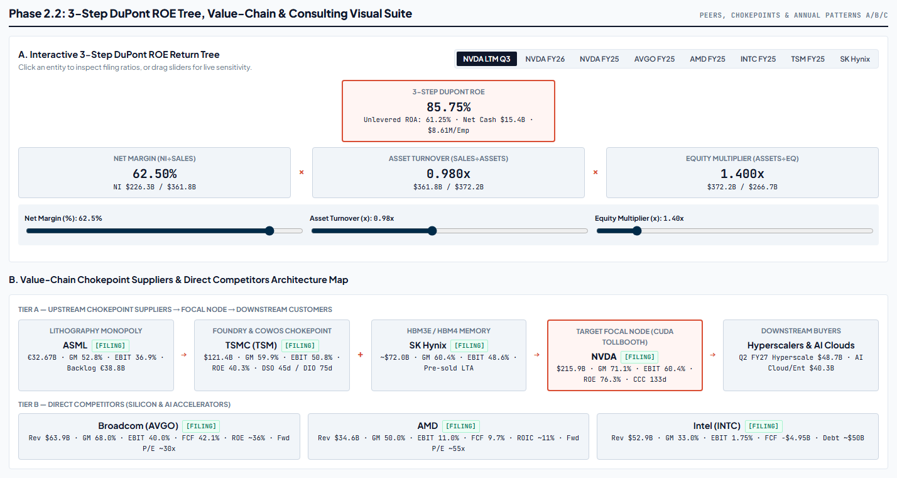
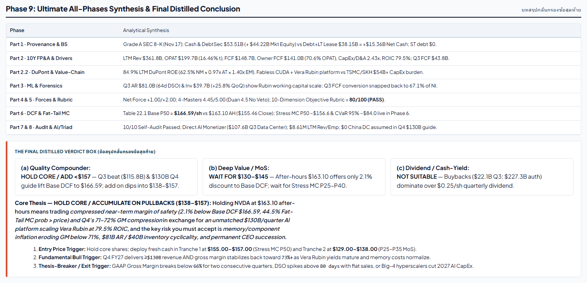

# FPA Value Chain MC — 10Y FP&A, Value-Chain, Fat-Tail Monte Carlo & AI/Triad Stock Analyzer (v3.1)

An institutional-grade Antigravity agent skill implementing a 9-Phase equity analysis framework for any stock ticker, combined with direct SEC EDGAR XBRL data extraction and a self-contained, zero-CDN print-ready HTML/CSS dashboard engine.

## Repository Structure

```text
fpa-valuechain-mc/
├── SKILL.md                      # Main Antigravity skill specification (Phases 1–9)
├── docs/
│   ├── build_presentation.py                # English 16:9 HTML -> PDF builder & validator
│   ├── slides.html                          # 16-slide English methodology & full function deck
│   └── fpa-valuechain-mc-presentation.pdf   # Print-ready 16-slide PDF (PV/DCF/MC + 14 live proofs)
├── scripts/
│   └── fetch_sec_edgar.py                   # Direct SEC EDGAR XBRL JSON API extractor (10-K & 10-Q)
├── examples/
│   └── nvda/
│       ├── index.html                       # Verified NVDA dashboard updated through Q3 FY27 (Nov 17, 2026 8-K)
│       ├── nvda_sec_xbrl.json               # Extracted SEC XBRL 10Y + quarterly dataset (CIK 0001045810)
│       ├── shot_01_p1_verdict.png           # P1A: Navigation, Provenance Strip & Dual-Layer Verdict
│       ├── shot_02_p1_q3_gate.png           # P1B: Q3 FY27 Beat Tracker & Accounting Identity Gate
│       ├── shot_03_p2_10y_table.png         # P2A: 10Y SEC XBRL Ledger & Commercial Drivers
│       ├── shot_04_p2_cvp_charts.png        # P2B: Cost-Volume-Profit (FC/VC/DOL) & Scale/Margin Charts
│       ├── shot_05_p22_dupont_vc.png        # P2.2A/B: Interactive 3-Step DuPont ROE & Value-Chain Map
│       ├── shot_06_p22_peers_matrix.png     # P2.2C: Industry & Supplier Benchmarking Matrix
│       ├── shot_07_p22_consulting_suite.png # P2.2D: Consulting Visual Suite (Patterns A, B, C)
│       ├── shot_08_p3_ml_forensics.png      # P3: Time-Series ML Forecast & Forensic Diagnostics
│       ├── shot_09_p4_forces_p5_masters.png # P4 & P5A: Force Alignment Matrix & 4-Masters Committee
│       ├── shot_10_p5_rubric.png            # P5B: 10-Dimension Objective Scoring Rubric (80/100 PASS)
│       ├── shot_11_p6_dcf_mc.png            # P6A: Jack Alexander DCF (22.1/22.2) & 10k Fat-Tail Monte Carlo
│       ├── shot_12_p6_actions_p7_audit.png  # P6B & P7: 3-Tier Action Zones, Mirror Test & 10-Point Audit
│       ├── shot_13_p8_ai_triad.png          # P8: AI Monetization Audit, Workforce Leverage & Geo Triad
│       └── shot_14_p9_verdict.png           # P9: Ultimate All-Phases Synthesis & Distilled Verdict
└── README.md
```

## Methodology Presentation & Live `NVDA` Dashboard Captures

- **English Presentation Deck (16-Slide PDF):** [docs/fpa-valuechain-mc-presentation.pdf](docs/fpa-valuechain-mc-presentation.pdf) ([HTML source](docs/slides.html) · [PDF builder](docs/build_presentation.py)) — explains core valuation math (**Present Value**, **FCFF Discounted Cash Flow**, **10,000-run Fat-Tail Student-$t$ Monte Carlo with CVaR 95%**), **Jack Alexander FP&A CVP & DuPont**, **10-Dimension Objective Rubric**, and walks through every function (`Phase 1` to `Phase 9`) with 14 live `NVDA` Q3 FY27 captures.

### Live `NVDA` Dashboard Captures (Q3 FY27 / SEC 8-K Verified)







## Key Capabilities

- **Direct SEC EDGAR XBRL Integration (`scripts/fetch_sec_edgar.py`):** Resolves any US ticker to its 10-digit CIK and fetches audited US GAAP 10-K (10 years) and 10-Q (with automatic YTD-to-standalone cash flow differencing) facts directly from `data.sec.gov/api/xbrl/companyfacts/`. Eliminates missing sub-lines (`D&A`, `SBC`, `Effective Tax Rate`, `Interest Expense`, `Operating Leases`, `CapEx/D&A`, `Owner FCF`, `Unlevered FCFF`, `Incremental ROIC`).
- **2-Wave Search + Strict Provenance Floor:** Enforces inline epistemic tags (`[FILING]`, `[CONSENSUS]`, `[PROXY]`, `[ASSUMP]`, `[SIM]`) and a strict `N/A` zero-fabrication policy for undisclosed metrics.
- **Full FP&A & Cost-Leverage Diagnostics:** Includes 10-year financial schedules, Cost-Volume-Profit (CVP Variable vs. Fixed Cost proxy, Break-Even Sales, Margin of Safety, Empirical DOL), Working Capital (`OC`, `DSO/DIO/DPO`, `CCC`), 3-Step DuPont ROE tree, Direct Competitor & Value-Chain Supplier Benchmarking, and Consulting Visual Suite (Patterns A, B, C).
- **10-Dimension Objective Rubric & Fat-Tail Monte Carlo:** Deterministic scoring (`0–100`) mapped to `PASS / CONDITIONAL PASS / GREY ZONE / FAIL`, Jack Alexander Table 22.1/22.2 DCF, and a 10,000-run Student-t (`df=5`) + 10% bear-jump Monte Carlo simulator with `CVaR 95%`.
- **Zero-CDN Print-Ready HTML Engine:** Pure HTML/CSS + inline SVG polylines with A4 landscape print-to-PDF support.

## Installation in Antigravity

Copy or clone this folder into either:
- **Workspace-level:** `<your-workspace>/.agents/skills/fpa-valuechain-mc/`
- **Global-level (all workspaces):** `~/.gemini/config/skills/fpa-valuechain-mc/`

## Standalone SEC EDGAR Script Usage

```bash
python scripts/fetch_sec_edgar.py NVDA --years 10 --quarters 6 --out nvda_sec_xbrl.json
```
